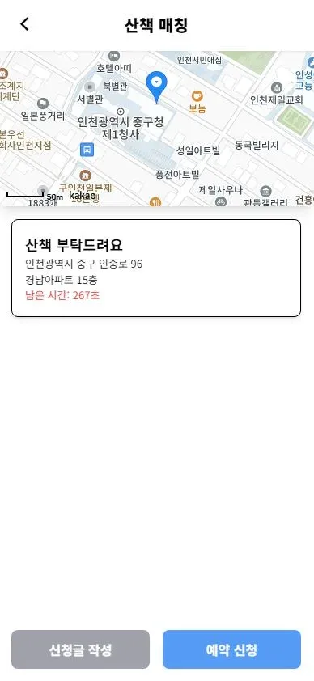
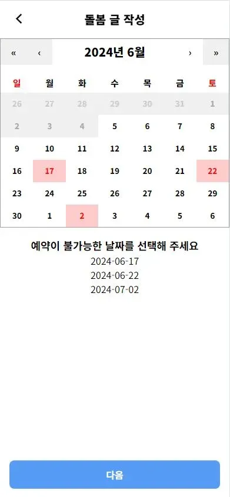
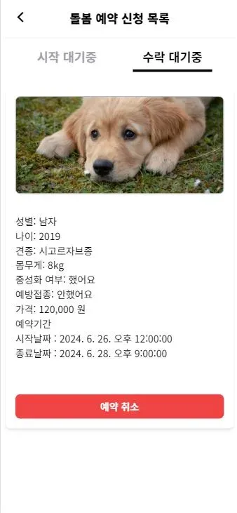
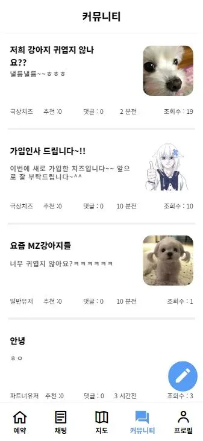
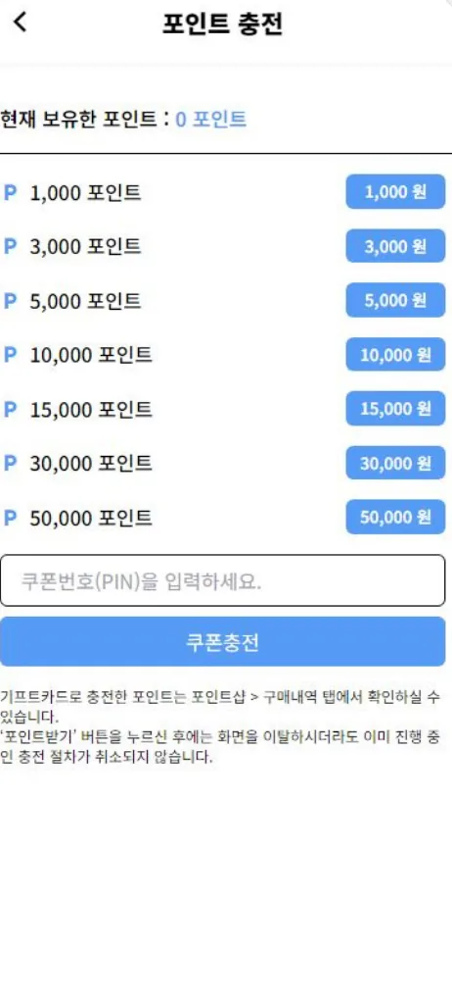
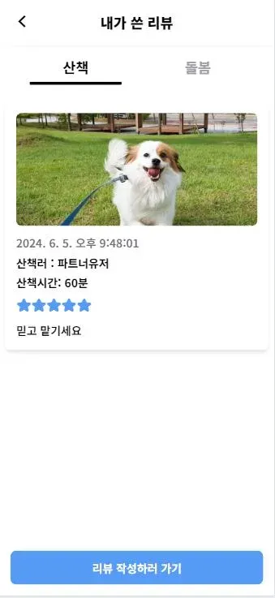
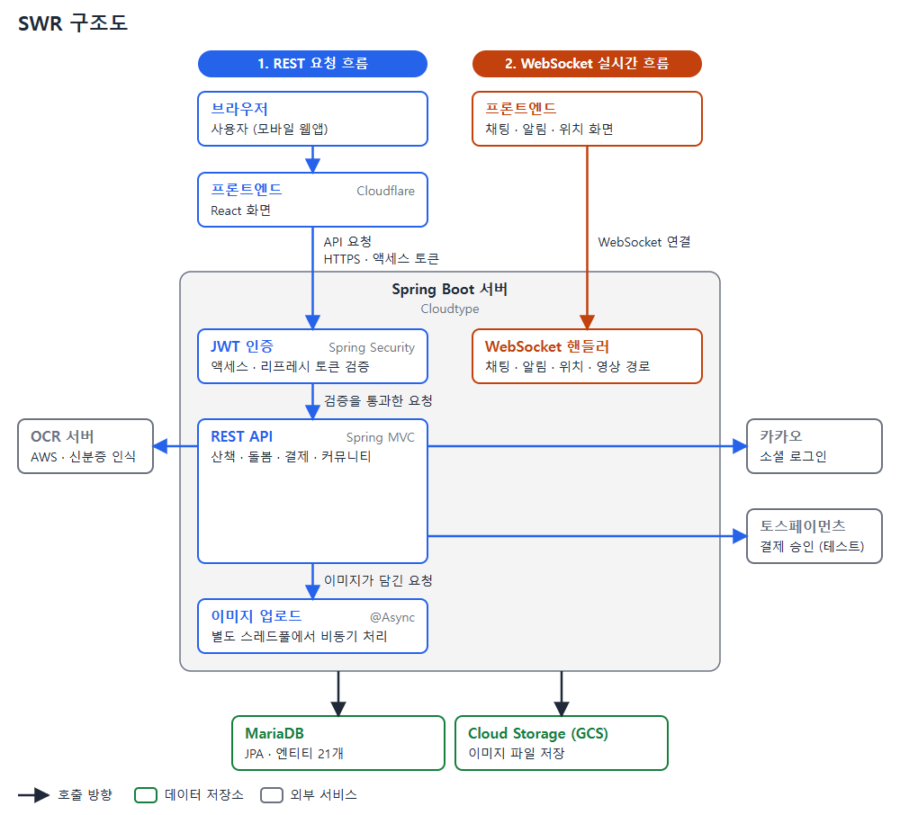
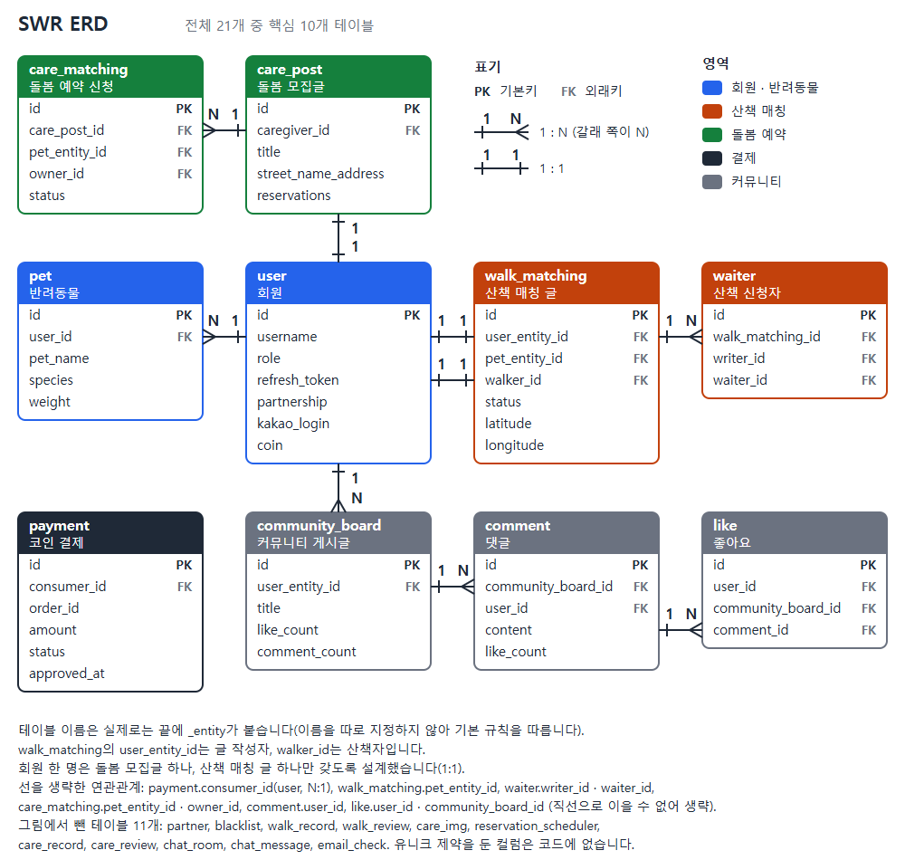

# SWR

반려동물 주인과 파트너(산책·돌봄 제공자)를 연결하는 반려동물 돌보미 웹앱. 대학 졸업 작품(종합설계)이다.

- 상태: 시연 때만 구동 (상시 배포 아님)
- 기간: 2024.03 ~ 2024.06
- 인원: 3명 (백엔드 REST API 1, 백엔드 WebSocket·OCR 서버 1, 프론트엔드 1)
- 개발일지: [[포트폴리오 제작 일지 #1] SWR 프로젝트 회고](https://velog.io/@swmoon7/포트폴리오-제작-일지-1-SWR-프로젝트-회고)

## 프로젝트 개요

### 왜 만들었나

국내에서 반려동물을 기르는 가구의 비율은 2010년 17.4%에서 2023년 28.2%로 늘었다(동물복지 국민의식조사).
반려동물을 처음 기르는 가구의 95.6%가 양육에 어려움을 겪었고, 가장 많이 꼽은 어려움은 "혼자 두고 외출·출근하는 것"이었다.
2023년 조사에서는 반려동물이 집에 혼자 있는 경우가 80.3%였고, 혼자 있는 시간은 평균 5시간 17분이었다.

이런 수요는 실제로도 보인다. 당근 같은 중고거래 앱에서 반려동물 산책 아르바이트를 구하는 글을 종종 볼 수 있고,
해외에서는 이미 도그워커(dog walker)라는 직업이 자리 잡고 있다.
하지만 국내에서는 이런 연결이 대부분 개인 간 게시글로 흩어져 있었다.

### 무엇을 만들고자 했나

산책과 돌봄을 맡기고, 인증된 파트너가 이를 받아 주는 과정을 하나의 플랫폼으로 묶어 보기로 했다.
매칭만 하는 서비스가 아니라 반려인끼리 정보를 나누는 커뮤니티와, 반려견과 함께 갈 수 있는 장소를 찾는 플레이스까지
한곳에서 쓸 수 있게 하는 것이 목표였다.

비슷한 서비스(도그메이트, 펫플래닛, 와요)와 비교해 다음 방향을 정했다(2024년 조사 기준).

| | 기존 서비스 | SWR |
|---|---|---|
| 이용 환경 | 앱 중심 (웹 예약이 안 되는 곳도 있음) | 웹 중심 |
| 제공 범위 | 산책 또는 돌봄 위주 | 산책, 돌봄, 플레이스, 커뮤니티 |
| 파트너 인증 | 서면·온라인 인터뷰, 전문 교육 | 교육 자료 학습 뒤 퀴즈 |
| 가격·수수료 | 회사 수수료 23~28.5% | 최저시급 기준 가격, 수수료 없음 |

- 대학 종합설계(졸업 작품) 과제로 3명이 만들었다.
- 나에게는 첫 Spring Boot 프로젝트였다. Java 기초 문법만 아는 상태에서 백엔드 REST API를 맡았다.

## 화면

| 산책 매칭 | 돌봄 글 작성 | 돌봄 신청 목록 |
|---|---|---|
|  |  |  |
| **커뮤니티** | **포인트 충전** | **내가 쓴 리뷰** |
|  |  |  |

## 주요 기능

일반 회원(반려인)과 인증된 파트너 두 유형이 있다.

1. 가입·로그인: 카카오 로그인, 이메일 인증을 거치는 일반 가입.
2. 파트너 인증: 신분증 인식(OCR 서버) → 추가 정보 → 영상 시청과 퀴즈 3단계. 통과하면 파트너가 된다.
3. 산책 매칭: 파트너가 현재 위치에서 지정한 거리 이내의 산책 글을 조회하고 신청한다. 거리는 Haversine 공식으로 계산한다. 시작·완료·미완료 기록과 리뷰가 이어진다.
4. 돌봄 예약: 파트너가 모집글(이미지, 이용 불가 날짜)을 올리고 반려인이 날짜를 골라 예약한다. 수락하면 코인을 차감한다. 하루 최대 2건까지 받고, 시작 24시간 전까지만 취소할 수 있다.
5. 코인 결제: 토스페이먼츠 테스트 환경으로 가상 코인을 충전한다. 실제 결제는 하지 않는다.
6. 커뮤니티: 게시글, 댓글, 좋아요. 이미지는 GCS에 저장한다.
7. 마이페이지: 정보 수정, 반려동물 등록·수정·삭제.
8. 실시간 채팅·알림·위치 공유(WebSocket): 팀장이 만든 기능이다. 아래 구조도에는 포함돼 있다.

## 기술 스택

| 구분 | 사용 기술 |
|---|---|
| 백엔드 | Java 17, Spring Boot 3.1.8, Spring Security, Spring Data JPA, JJWT 0.12.3, springdoc-openapi 2.2.0(Swagger), WebFlux(WebClient), JavaMail, Gradle |
| 이미지 | Google Cloud Storage (Spring Cloud GCP Storage 1.2.5) |
| 데이터베이스 | MariaDB(배포), MySQL(로컬 개발) |
| 실시간(팀장 담당) | Spring WebSocket |
| OCR 서버(팀장 담당) | Python FastAPI, easyocr. AWS |
| 프론트엔드(팀원 담당) | React, TypeScript, Tailwind CSS, axios. PWA. 이 저장소에는 없다 |
| 외부 서비스 | 카카오 로그인, 토스페이먼츠(테스트 환경), 카카오맵 |
| 배포 | 백엔드 Cloudtype, 프론트 Cloudflare, OCR 서버 AWS |

## 구조도



- REST 흐름: 브라우저 → 프론트(Cloudflare) → Spring Boot 서버(Cloudtype). 서버에서는 Spring Security의 JWT 필터가 액세스·리프레시 토큰을 검증하고, 통과한 요청이 REST API로 간다. REST API는 OCR 서버(AWS), 카카오, 토스페이먼츠를 호출한다.
- 이미지가 담긴 요청은 별도 스레드풀에서 `@Async`로 GCS에 업로드하고, 나머지 데이터는 MariaDB에 JPA로 저장한다.
- WebSocket 흐름(채팅·알림·위치·영상)은 같은 서버 안의 핸들러가 받는다. 서버를 따로 두지 않고 한 서버에서 역할을 나눴다.

## ERD



엔티티는 21개이고, 그림에는 핵심 10개를 그렸다. 회원 한 명이 돌봄 모집글 하나, 산책 매칭 글 하나만 갖도록 설계했다(1:1). 채팅 관련 엔티티 2개는 팀장이 만든 것이다.

## 내가 맡은 부분

3명 팀에서 백엔드 REST API, JWT 인증, JPA를 맡았다. 팀장은 WebSocket(채팅·알림·위치)과 OCR 서버를, 팀원은 프론트엔드를 맡았다.

- 인증: 카카오 로그인, 일반 가입, 이메일 인증, Spring Security + JWT 인증·인가(액세스·리프레시 토큰, 로그아웃)
- 회원: 마이페이지, 반려동물, 파트너 등록(OCR 서버 호출, 회원 정보와 일치 비교, 퀴즈 채점)
- 서비스: 산책 매칭, 돌봄 예약, 결제(토스페이먼츠 테스트 환경), 커뮤니티와 이미지(GCS)
- 협업: Swagger로 REST API를 문서화해 프론트에 전달
- 구조 결정: 서버 2대를 쓸 때 서버·프론트 사이에 토큰 유효성 문제가 생겨, 한 서버에서 역할을 나누는 방식으로 정리했다.
- 하지 않은 것: 채팅·알림·위치·영상(WebSocket), OCR 서버, 프론트엔드. 돌봄 예약·산책 매칭에서 채팅방을 만들고 알림을 보내는 호출 부분도 팀장 담당이다.

Spring Boot는 이 프로젝트에서 처음 썼다.

### 문제 해결

**1. 이미지 업로드 지연**
- 문제: 서버에 이미지를 두기 어려워 무료로 쓸 수 있는 GCS를 썼는데, 무료는 미국 서버만 가능해 업로드·삭제·수정이 느렸다.
- 해결: GCS 업로드를 `@Async`(전용 스레드풀)로 비동기 처리하고, GCS 리전을 미국에서 한국으로 바꿨다.
- 결과: 두 조치를 함께 적용해 작업 시간이 평균 6~10초에서 2~4초로 줄었다.

**2. 멘토링 뒤 구조 변경**
- 문제: 로그인·게시판·매칭이 대부분 동작하던 때 멘토링에서 구조를 지적받았다. API 요청마다 카카오 토큰으로 카카오 API를 호출해 사용자를 확인하고 있었고, JDBC로 SQL을 직접 쓰고 있었으며, 패키지는 로직 단위(컨트롤러·서비스 등)로 나뉘어 있었다.
- 해결: 서버가 자체 토큰을 발급하는 Spring Security + JWT로 바꿔 카카오 호출을 로그인 때 한 번으로 줄였다. 리프레시 토큰은 DB에 저장해 대조한다. JDBC는 JPA로, 패키지는 비즈니스 단위로 옮겼다. 한 번에 끝낸 교체가 아니라 이후 기능 작업과 함께 이어졌다.
- 결과: 중간에 기술을 바꾸면서 사실상 새로 만들게 됐다. 힘들었지만 큰 경험이 됐다.

## 실행 방법

필요한 것: JDK 17, MySQL 또는 MariaDB

```powershell
.\gradlew bootRun
```

- 설정 파일(`application.yml`)에 DB 접속 정보, JWT 비밀 키, GCS 인증 정보, 카카오·토스 키, 메일 계정이 필요하다. 값은 직접 채운다.
- 프론트엔드와 OCR 서버는 이 저장소에 없다.
- Swagger 화면은 `/swagger-ui.html`에서 본다.

## 폴더 구조

```
swr
└─ src/main/java/io/cloudtype/Demo
   ├─ login, mail      카카오·일반 가입, 이메일 인증
   ├─ jwt              JWT 필터, 토큰 발급·검증
   ├─ mypage           마이페이지, 반려동물, 파트너 등록
   ├─ walk             산책 매칭
   ├─ care             돌봄 예약
   ├─ payment          코인 결제
   ├─ community        게시글·댓글·좋아요, 이미지
   ├─ review, usage    리뷰, 이용 내역
   ├─ config           보안, CORS, 비동기, WebClient
   └─ chat, notification, location, video   WebSocket (팀장 담당)
```

## 관련 글

velog [@swmoon7](https://velog.io/@swmoon7)

- [[포트폴리오 제작 일지 #1] SWR 프로젝트 회고](https://velog.io/@swmoon7/포트폴리오-제작-일지-1-SWR-프로젝트-회고)
